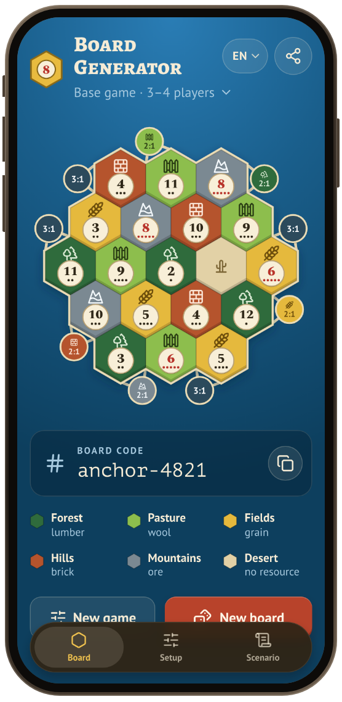
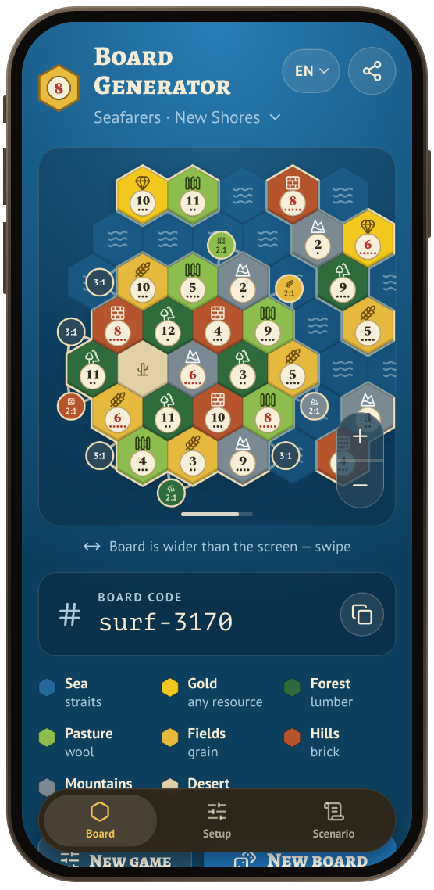
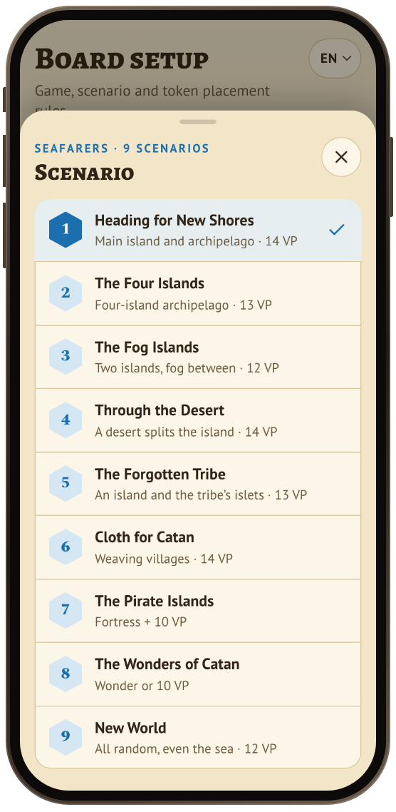
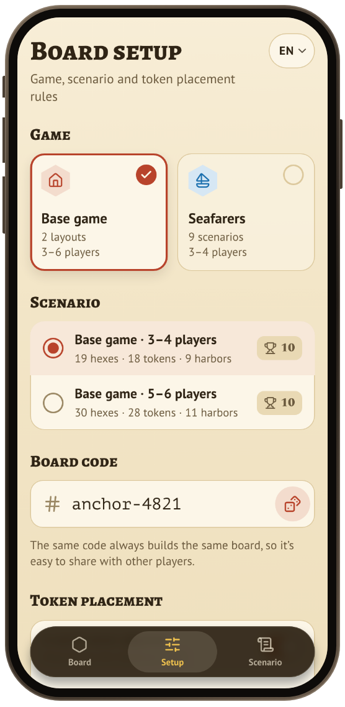
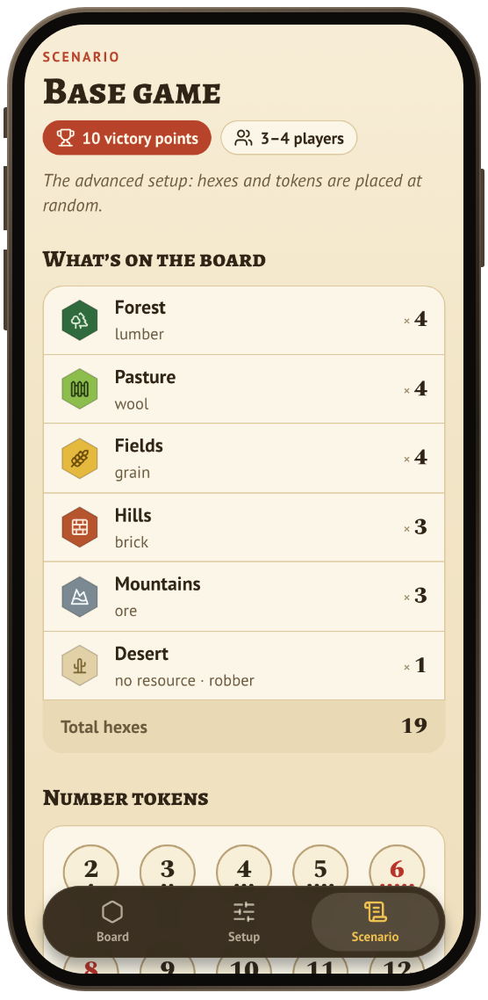
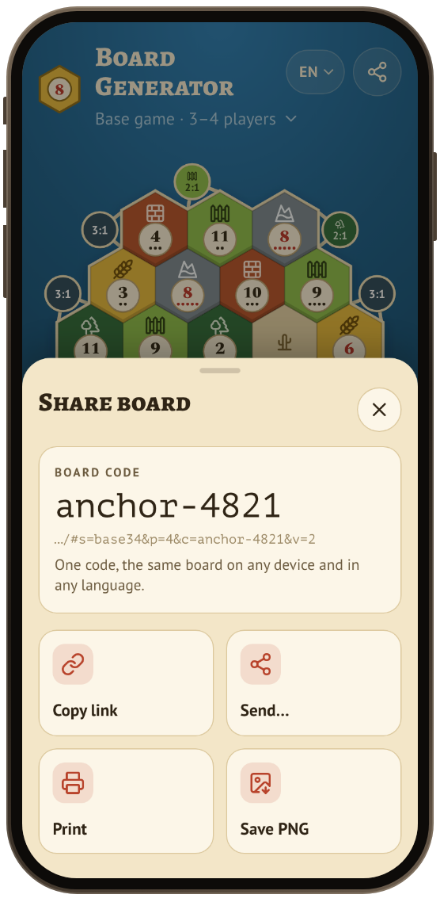

<p align="center">
  
</p>

<h1 align="center">Board Generator for CATAN</h1>

A phone-first web app (PWA) that deals fair, shareable boards for the **CATAN** base game (3–4 and
5–6 players) and all nine **Seafarers** scenarios.

It is a *companion* to the physical game: you still play with your own box. The app shuffles and
deals: which tile and number go where, which harbors go on the frame, and what to take from the box.

**[Project page](https://catan.silachev.com/)**, in English,
[Español](https://catan.silachev.com/es/), [Deutsch](https://catan.silachev.com/de/),
[Русский](https://catan.silachev.com/ru/) and [Српски](https://catan.silachev.com/sr/).

> **Status:** in development. Work is planned in
> [issues](https://github.com/asilachev/catan-board-generator/issues) and
> [milestones](https://github.com/asilachev/catan-board-generator/milestones).

<p align="center">
  
  &nbsp;
  
  &nbsp;
  
</p>
<p align="center">
  
  &nbsp;
  
  &nbsp;
  
</p>
<p align="center"><sub>A dealt board · Seafarers on the rulebook's map · the nine scenarios · setup · what to take from the box · sharing</sub></p>

## What it does

- **Deals 11 boards:** the base game for 3–4 and 5–6 players, and Seafarers scenarios 1–9 with
  their 3- and 4-player layouts. Seafarers boards keep the islands, sea and harbors where the
  rulebook's maps put them and shuffle only what each scenario allows, or deal the map exactly as
  printed.
- **Keeps it fair:** 6 and 8 never touch, equal numbers stay apart and terrain is spread out; each
  rule can be switched off. When a rule can't be met everywhere, it says so.
- **Same code, same board:** every board has a code such as `anchor-4821`. Send the link or just the
  code and everyone sees the same island, on any device and in any language. Links from the first
  version still open the boards they showed then.
- **Says what to take from the box:** hexes, number tokens, harbors and extra pieces for the
  scenario, its own rules, its victory target, and where to look in the rulebook.
- **Made for the table:** big tiles with probability dots, a legend, wide Seafarers archipelagos
  that scroll and zoom, the deal animated like at the table, print and Save PNG.
- **Works offline:** it installs to the home screen, opens without a network and keeps the screen
  awake while the board is open.
- **Speaks five languages:** English, Español, Deutsch, Русский and Српски (Cyrillic). It starts in
  your phone's language; the menu at the top switches it.

## Rules

[`docs/rules.md`](docs/rules.md) lists every board's tiles, tokens, harbors and victory target with
the rulebook page it comes from, and the rulings the app uses where the rules leave a gap. The
official rulebooks are on [catan.com](https://www.catan.com/understand-catan/game-rules). The app's
design is in [`docs/design.md`](docs/design.md).

## Credits and legal

- **License:** the code and docs are under the [MIT License](LICENSE). It covers this project only:
  it grants nothing in the CATAN trademarks or game content, and the fonts and icons below keep
  their own licenses.
- **CATAN®**, **CATAN – Seafarers** and the CATAN logo are trademarks of CATAN GmbH. Rules, scenario
  names and game content © CATAN GmbH and its licensed publishers.
- This is an **unofficial, free, non-commercial fan project**. It is not affiliated with, sponsored
  or endorsed by CATAN GmbH or its publishers. You need your own copy of the game to play.
- **Icons:** [Lucide](https://lucide.dev) (ISC). The logo, tokens, tiles and the cactus are our own
  drawings.
- **Fonts:** Alegreya SC, PT Sans, PT Mono and Spectral, under the SIL Open Font License 1.1, bundled
  from [Fontsource](https://fontsource.org).

## Deploy

The app is a static site. Host it on Vercel or on your own server with Docker: both serve the same
build with the same caching and security headers. Either way it needs HTTPS, which installing, the
offline mode, the clipboard and the screen wake lock all require. Both tell search engines not to
index the app (`X-Robots-Tag: noindex`); the [project page](https://catan.silachev.com/) is its
public face.

### Vercel

[`vercel.ts`](vercel.ts) holds the whole setup: Vite, `npm run build`, `dist/`, caching and headers.

1. **Import the repo.** In Vercel, choose *Add New → Project*, import
   `asilachev/catan-board-generator` and deploy. No settings to change.
2. **Add the domain.** In the project's *Settings → Domains*, add `app.catan.silachev.com`, then
   create the DNS record Vercel shows (a CNAME for a subdomain). HTTPS is automatic.
3. **Updates are automatic.** Every push to `master` deploys to production, and every pull request
   gets a preview URL.
4. **Analytics** (optional). Turn on *Web Analytics* in the Vercel project. Builds made on Vercel
   then count page views: anonymous, no cookies. Builds made anywhere else contain no analytics.

### Docker (self-hosted)

Unprivileged nginx. Every push to `master` publishes
`ghcr.io/asilachev/catan-board-generator:latest` for amd64 and arm64.

1. **Start it.** Copy [`docker-compose.yml`](docker-compose.yml) to the server and run
   `docker compose up -d`. It serves on port 8080; the image is public, so no login is needed.
2. **Add HTTPS.** Put it behind your reverse proxy (Caddy, Traefik, nginx…).
3. **Update** with `docker compose pull && docker compose up -d`. The next time the app opens, phones
   show "A new version is ready · Reload".

To build from source instead, run `docker build -t catan-boards . && docker run -p 8080:8080 catan-boards`.

### Landing page (GitHub Pages)

`.github/workflows/pages.yml` captures the app in five languages, builds `_site/` and deploys it
from `master`. In the repo's *Settings → Pages*, the source is *GitHub Actions* and the custom domain
is `catan.silachev.com`, with a DNS CNAME `catan` → `asilachev.github.io` and HTTPS enforced. A run
can also be started by hand: `gh workflow run pages.yml`.

## Development

[](https://github.com/asilachev/catan-board-generator/actions/workflows/ci.yml)

```sh
npm ci
npm run dev        # http://localhost:5173 (use `npm run dev -- --host` to open it on your phone)
npm test           # Vitest
npm run build      # production build in dist/
npm run site:shots # the app in five languages, for the landing page
npm run site       # landing page in _site/
```

Built with Vite, React and TypeScript, with a pure TypeScript board engine in `src/engine`.
Contributor and agent guidance, including commands, layout, workflow and conventions, is in
[AGENTS.md](AGENTS.md).
